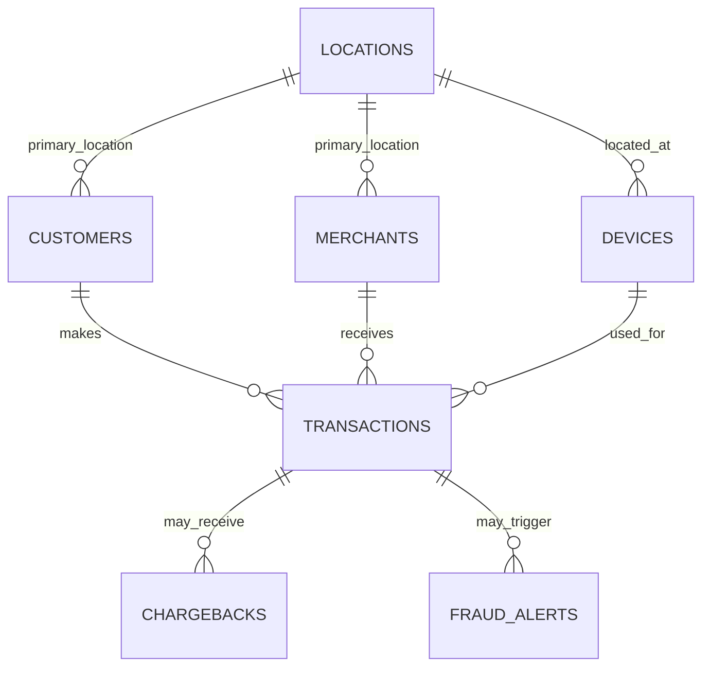

# ER Diagram — Fintech Fraud Analytics

## Relationship notes

- One location can be associated with many devices, customers, and merchants.
- A customer can make many transactions; each transaction references one customer, merchant, and device when that information is available.
- A transaction can have zero or more chargebacks and fraud alerts.
- The `TRANSACTIONS` table is the central fact table; the other tables provide customer, merchant, device, location, dispute, and review context.
- Use the foreign keys and indexes in `oracle/01_schema.sql` to preserve relationships and support common joins.
