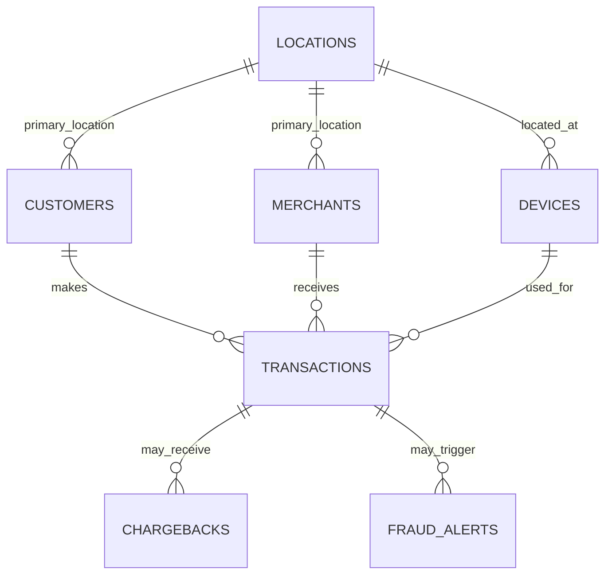

# ER Diagram — Fintech Fraud Analytics

One location can serve many devices, customers, and merchants. A customer, merchant, or device can be linked to many transactions. A transaction can have zero or more chargeback records and fraud alerts. Transactions form the central fact table, while the other tables provide context for analysis.

The Oracle constraints and indexes are defined in `oracle/01_schema.sql`.
